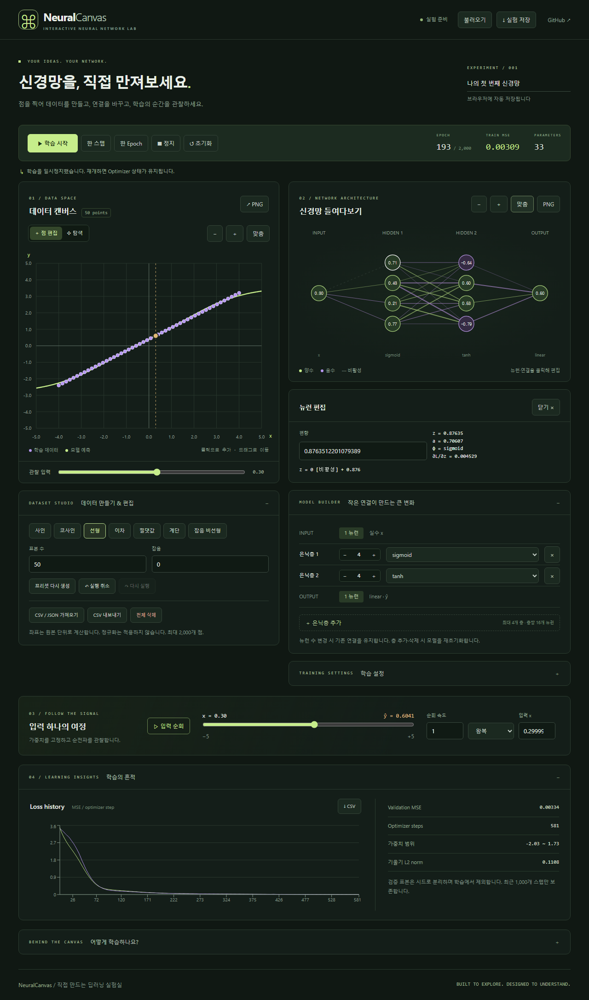

# NeuralCanvas

**직접 데이터를 만들고, 신경망을 설계하고, 학습의 순간을 관찰하는 딥러닝 실험실.**

1차원 회귀를 위한 브라우저 실험실입니다. TypeScript로 직접 구현한 MLP가 실제 순전파·역전파와 SGD/Adam 업데이트를 수행합니다. 예측 곡선, 연결선, 활성화 값과 손실 이력은 실제 모델에서 계산합니다.

목표 공개 주소: https://oyueo-mm.github.io/NeuralCanvas/ (배포 상태는 [개발 결과](docs/RESULTS.md) 참조)



## 주요 기능

- 좌표평면 클릭으로 점 추가, 드래그 이동, 정확한 x/y 편집, 삭제, 실행 취소/다시 실행
- 선형·이차·사인·코사인·절댓값·계단·잡음 비선형 프리셋, 표본 수·잡음·시드 설정
- 은닉층 0~4개, 층당 1~16개 뉴런, linear/sigmoid/tanh/ReLU/Leaky ReLU
- 실제 연결 선택, 가중치·편향 수정, 연결 비활성화와 재활성화
- Xavier·He·Zero 초기화, SGD·Adam, 배치 크기·학습률·Epoch·검증 비율·클리핑 설정
- Web Worker 학습, 일시정지/재개/정지, 한 배치 또는 한 Epoch 실행
- 실제 Train/Validation MSE와 예측 곡선, 뉴런별 z/a, 연결별 기여량과 최근 기울기
- 모델을 고정한 입력 순회: 왕복·반복·한 방향, 속도 조절, 수동 x 입력
- 데이터/신경망 확대·축소 및 드래그 이동, 자동 화면 맞춤, 반응형 탭
- 실험 JSON 저장/복원, 브라우저 자동 저장, 데이터 CSV/JSON 가져오기, CSV·PNG 내보내기

## 실행

Node.js 24 이상을 권장합니다.

```bash
npm ci
npm run dev
```

표시되는 URL의 `/NeuralCanvas/`에서 사용합니다. 데이터 포인트를 만들고 모델을 편집한 뒤 **학습 시작**을 누릅니다. 연결 또는 뉴런을 선택하면 실제 파라미터를 수정할 수 있습니다. 학습을 일시정지하고 **입력 순회**를 누르면 각 뉴런의 계산값을 관찰합니다.

```bash
npm test
npm run build
npx playwright install chromium webkit
npm run test:e2e
npm run benchmark
```

## 구조와 기술

React · TypeScript · Vite · Tailwind CSS · SVG · Canvas 2D(PNG 내보내기) · Web Worker · Recharts · Vitest · Playwright · GitHub Actions/Pages. TensorFlow.js에 의존하지 않습니다.

| 파일 | 역할 |
| --- | --- |
| `src/engine.ts` | MLP, 활성화·미분, 역전파, SGD/Adam, 시드·데이터 |
| `src/training.ts` | 결정론적 분할·셔플·미니배치·Epoch |
| `src/worker.ts` | 버전이 있는 명령·스냅샷, 타이머 학습 |
| `src/Plot.tsx`, `src/Network.tsx` | 좌표계·예측 곡선·실제 신경망 시각화 |
| `src/App.tsx` | 편집·학습 제어·입력 순회·분석 |
| `src/storage.ts` | 검증된 JSON 복원, CSV/PNG 다운로드 |
| `src/*.test.ts`, `tests/lab.spec.ts` | 수학·학습·브라우저 검증 |

## 수학과 검증

MSE는 **배치 평균**이며, 역전파는 `2(ŷ−y)/N`에서 시작합니다. 출력층의 기본 활성화는 linear입니다. 비활성 연결은 순전파·역전파·Optimizer 업데이트에서 모두 제외합니다. Adam은 β₁=0.9, β₂=0.999, ε=10⁻⁸과 편향 보정을 사용합니다.

자세한 내용: [수학](docs/MATHEMATICS.md) · [아키텍처](docs/ARCHITECTURE.md) · [검증](docs/TESTING.md) · [성능](docs/PERFORMANCE.md) · [디자인](docs/DESIGN.md) · [개발 결과](docs/RESULTS.md)

## 상태와 한계

데이터·구조·파라미터·설정 변경은 Worker를 종료하고 학습 세션을 초기화합니다. 일시정지는 Worker와 Optimizer 상태를 유지합니다. 정지·파일 복원 후 새로 시작하면 Optimizer 모멘트와 셔플 위치는 초기화됩니다. 파일은 모델 가중치와 이력을 복원하며 비트 단위 학습 재개 체크포인트는 아닙니다.

원본 좌표로 학습하며 자동 정규화는 적용하지 않습니다. 큰 입력·학습률에서는 발산할 수 있습니다. 실험 복원 시 행렬 크기·유한성·상한·버전을 검사하고, 코드를 실행하지 않습니다. 무한 손실 이력을 쌓지 않고 최근 1,000개 배치만 보존합니다.

향후 확장: 터치 핀치, 선택 뉴런 중심 확대, 활성화 함수 그래프, 가중치 히스토그램, 정규화, 체크포인트, 2차원 분류·결정 경계, CNN, Gradient Flow 및 Optimizer 비교.

## GitHub Pages

Vite base는 `/NeuralCanvas/`입니다. 저장소 **Settings → Pages → Source → GitHub Actions**로 설정하면 main push에서 타입 검사·단위 테스트·브라우저 테스트·빌드 후 배포합니다. [Vite 배포 지침](https://vite.dev/guide/static-deploy.html)을 참고했습니다.

## 참고자료와 라이선스

[TensorFlow Playground](https://playground.tensorflow.org/) · [Nielsen](http://neuralnetworksanddeeplearning.com/) · [Deep Learning](https://www.deeplearningbook.org/). 프로젝트의 직접 작성 코드는 MIT 라이선스입니다. 외부 라이브러리는 각 패키지 라이선스를 따릅니다.
