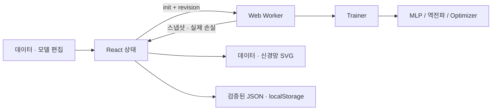

# 아키텍처

수학 엔진은 React·DOM·Worker API에 의존하지 않습니다. Trainer가 미니배치와 검증 분할을 관리하고, Worker가 타이머로 실행합니다. UI는 수신한 모델 스냅샷을 기준으로 그래프·예측·활성화를 계산합니다.

## 동기화 정책

Worker는 init 시 모델과 데이터를 구조화 복사로 받습니다. 이후 run/pause/step/epoch 명령을 처리합니다. 모든 명령·응답에는 revision을 포함합니다. UI 편집 시 revision 증가와 Worker terminate를 **먼저** 수행하고 변경된 모델을 반영합니다. 종료 전 도착한 오래된 이벤트는 revision 검사로 무시합니다. 편집 시 아직 UI에 전달되지 않은 배치는 버리고 마지막 수신 상태를 사용합니다.

일시정지 명령은 Worker 이벤트 큐에서 진행 중 작업 뒤 처리됩니다. 작업은 최대 약 16ms 계산 묶음이며 이벤트 사이에서 pause를 처리합니다. pause 응답으로 마지막 가중치를 동기화합니다. 재개는 같은 Trainer와 Adam 모멘트·난수 상태를 유지합니다. 정지는 Worker를 종료하고 마지막 UI 모델을 유지합니다.

구조·데이터·설정·파라미터 편집은 세션·이력·기울기를 초기화합니다. 파일 복원은 저장된 이력·가중치를 읽지만 Adam 모멘트·배치 커서·난수 위치는 저장하지 않습니다. 재시작 시 새 Optimizer로 가중치에서 학습을 이어갑니다.

## 모델 편집

층 수가 같고 마지막 뉴런을 추가/제거할 때 동일한 배열 인덱스의 뉴런·연결을 유지합니다. 새 파라미터만 초기화합니다. 층 추가·삭제에서는 의미가 달라진 층 사이 연결을 복사하지 않고 전체 모델을 초기화합니다. 이 정책은 UI에 표시합니다. 모든 인접층 연결에는 별도 enabled 마스크가 존재합니다. 값 0과 비활성 상태를 구분합니다.

## 학습과 메모리

시드 기반 셔플로 검증 데이터를 분리하고 학습 배열만 역전파에 사용합니다. 검증 비율 0은 검증 손실을 생성하지 않습니다. 배치별 Train/Validation MSE는 전체 각 분할로 계산합니다. 최근 1,000개 배치 이력을 보존하며 가중치의 전체 시간 이력을 저장하지 않습니다. Worker는 약 32ms 이상의 간격으로 다음 계산 묶음을 예약합니다.

## 저장과 보안

JSON에 version·이름·모델·데이터·설정·이력·입력값을 저장합니다. 복원은 최대 5MB, 최대 2,000개 점, 최대 5개 학습층, 최대 16개 뉴런 및 행렬 shape를 검사합니다. 활성화/Optimizer는 화이트리스트입니다. 유한한 숫자와 허용 범위를 확인합니다. JSON·CSV 내용을 코드로 실행하지 않습니다. localStorage는 장치·브라우저·origin별이며 debounce 700ms로 저장합니다.
