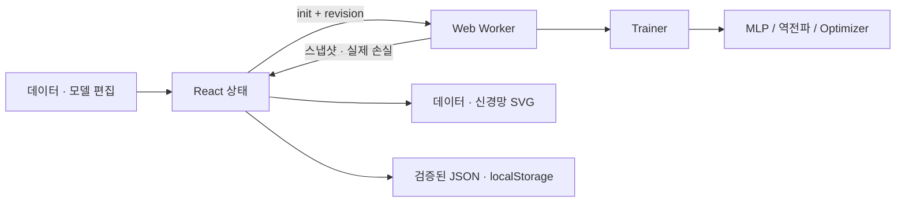

# 아키텍처

수학 엔진은 React·DOM·Worker API에 의존하지 않습니다. Trainer가 미니배치와 검증 분할을 관리하고, Worker가 타이머로 실행합니다. UI는 수신한 모델 스냅샷을 기준으로 그래프·예측·활성화를 계산합니다.

UI 개편 후 실험 상태와 Worker 수명은 `useLab.ts`에 유지합니다. App은 반응형 탭·드로어·도크를 구성하며, 화면 전환은 Worker를 재생성하지 않습니다. Plot/Network는 마운트를 유지하고 CSS로 표시를 전환해 확대·이동 상태를 보존합니다. 모바일의 숨긴 시각화에는 마지막 표시 스냅샷을 전달하여 불필요한 렌더링을 줄이고, 다시 표시할 때 최신 실제 모델을 전달합니다. 모델 자체와 Worker는 항상 상위 상태에서 계속 갱신됩니다.

Plot은 가중치·뷰포트 변경 시 예측 경로를 캐시하며 입력 x만 바뀔 때 전체 241개 예측 곡선을 재계산하지 않습니다. 분석은 요청할 때 렌더링하고 Recharts는 별도 청크로 로드합니다. ResizeObserver는 실제 SVG 영역을 측정하며, 숨긴 영역의 0 크기는 유지된 뷰를 덮어쓰지 않습니다.

## 동기화 정책

Worker는 init 시 모델과 데이터를 구조화 복사로 받습니다. 이후 run/pause/step/epoch 명령을 처리합니다. 모든 명령·응답에는 revision을 포함합니다. UI 편집 시 revision 증가와 Worker terminate를 **먼저** 수행하고 변경된 모델을 반영합니다. 종료 전 도착한 오래된 이벤트는 revision 검사로 무시합니다. 편집 시 아직 UI에 전달되지 않은 배치는 버리고 마지막 수신 상태를 사용합니다.

일시정지 명령은 Worker 이벤트 큐에서 진행 중 작업 뒤 처리됩니다. 작업은 최대 약 16ms 계산 묶음이며 이벤트 사이에서 pause를 처리합니다. pause 응답으로 마지막 가중치를 동기화합니다. 재개는 같은 Trainer와 Adam 모멘트·난수 상태를 유지합니다. 정지는 Worker를 종료하고 마지막 UI 모델을 유지합니다.

구조·데이터·설정·파라미터 편집은 세션·이력·기울기를 초기화합니다. 파일 복원은 저장된 이력·가중치를 읽지만 Adam 모멘트·배치 커서·난수 위치는 저장하지 않습니다. 재시작 시 새 Optimizer로 가중치에서 학습을 이어갑니다.

## 모델 편집

층 수가 같고 마지막 뉴런을 추가/제거할 때 동일한 배열 인덱스의 뉴런·연결을 유지합니다. 새 파라미터만 초기화합니다. 층 추가·삭제에서는 의미가 달라진 층 사이 연결을 복사하지 않고 전체 모델을 초기화합니다. 이 정책은 UI에 표시합니다. 모든 인접층 연결에는 별도 enabled 마스크가 존재합니다. 값 0과 비활성 상태를 구분합니다.

## 학습과 메모리

시드 기반 셔플로 검증 데이터를 분리하고 학습 배열만 역전파에 사용합니다. 검증 비율 0은 검증 손실을 생성하지 않습니다. 배치별 Train/Validation MSE는 전체 각 분할로 계산합니다. 최근 1,000개 배치 이력을 보존하며 가중치의 전체 시간 이력을 저장하지 않습니다. Worker는 약 32ms 이상의 간격으로 다음 계산 묶음을 예약합니다.

## 회귀·분류 및 결정 경계

`Model.task`가 없으면 기존 회귀 모델로 해석합니다. 분류 모델은 task=classification, 입력 폭 2, sigmoid 출력 폭 1입니다. `Point`는 분류에서 x/y를 두 입력 좌표로, label을 0/1 정답으로 사용합니다. 회귀 데이터의 y 의미는 바뀌지 않습니다.

모드 전환 시 현재 실험을 모드별 캐시에 보관하고 반대편 모델·데이터·설정·이력·관찰 좌표를 복원합니다. Undo/Redo와 프리셋 선택은 같은 실행 중 모드별로 유지합니다. Worker는 전환 전에 종료하며 새 모드 학습에는 새 Optimizer를 사용합니다. 자동 저장 및 v2 JSON은 현재 실험과 반대 모드 스냅샷 `other`를 함께 담습니다. v1 JSON은 그대로 읽습니다. Optimizer 모멘트와 Undo 이력은 파일에 저장하지 않습니다.

결정 경계는 학습 Worker와 별도 Worker에서 계산합니다. `useBoundary`는 모델·뷰포트·해상도·색상 변경만 요청하며 140ms 갱신 제한과 한 번에 한 요청, 최신 요청 병합을 사용합니다. 입력 관찰이나 점 선택에는 재계산하지 않습니다. 오래된 뷰포트 결과는 버리며 숨긴 모바일 데이터 탭에서는 경계 Worker를 종료합니다. Float32Array를 transfer한 후 작은 Canvas 이미지를 SVG에 포함하여 화면과 PNG 내보내기가 같은 경계를 사용합니다.

연속 그리기는 마우스 10px, 터치 14px 이상 이동했을 때 점을 추가합니다. 스트로크 중에는 Plot의 미리보기만 바꾸고 pointerup에서 한 번 커밋합니다. 핀치 시작·pointercancel은 미리보기를 버립니다. 배경 SVG image의 기본 HTML drag 동작은 막아 포인터 취소를 방지합니다.

신경망은 화면을 기준으로 노드를 압축하는 대신 논리 좌표에서 노드 간격 60, 레이어 간격 최소 150을 확보하고 화면 맞춤 배율을 적용합니다. 낮은 배율에서는 숫자 라벨을 숨기고, 자세한 값은 선택한 Inspector에서 제공합니다. 확대·이동과 모바일 탭 간 뷰 상태는 유지합니다.

## JSON 검증

JSON에 version·이름·모델·데이터·설정·이력·입력값을 저장합니다. 복원은 최대 5MB, 최대 2,000개 점, 최대 5개 학습층, 최대 16개 뉴런 및 행렬 shape를 검사합니다. 활성화/Optimizer는 화이트리스트입니다. 유한한 숫자와 허용 범위를 확인합니다. JSON·CSV 내용을 코드로 실행하지 않습니다. localStorage는 장치·브라우저·origin별이며 debounce 700ms로 저장합니다.
