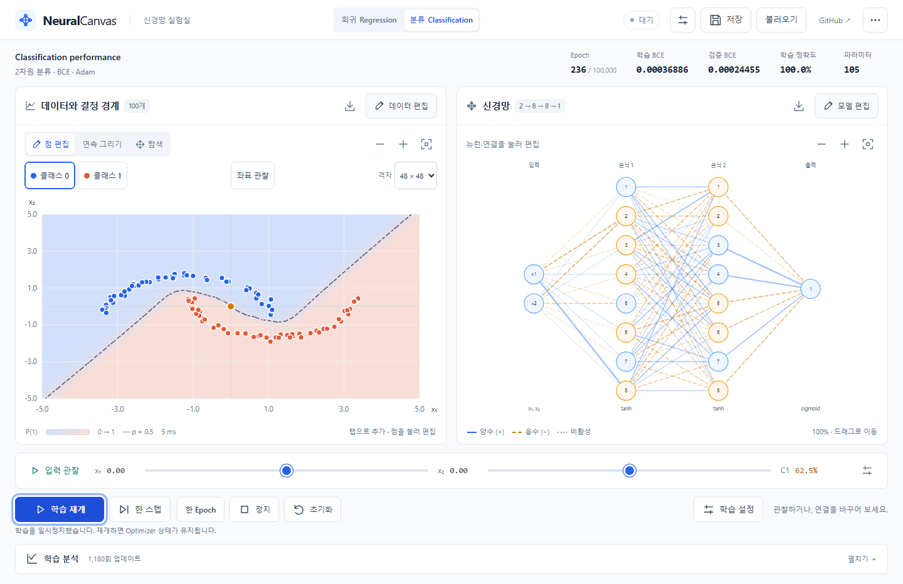

# 데이터 UX · 신경망 가독성 · 이진 분류

2026-10-21 KST 구현 및 검증 기록입니다.



## 데이터 입력

점 편집은 클릭/탭 추가, 기존 점 드래그 이동, 좌표 및 클래스 편집, 삭제를 제공합니다. 연속 그리기는 마우스 10px·터치 14px 이상 이동했을 때만 새 점을 추가합니다. 전체 스트로크를 한 번 커밋하므로 Undo 한 번으로 취소합니다. 2,000개 상한, 핀치 시작·포인터 취소 시 스트로크 폐기, Undo/Redo를 유지합니다. 편집 패널 상단에 Undo/Redo를 배치했습니다.

회귀 프리셋 7개를 유지하고, 분류에 XOR, Two moons, Concentric circles, Gaussian blobs, Spiral을 추가했습니다. 클래스 0/1의 활성 입력 버튼은 44px 이상의 터치 높이이며, 점의 label은 이동해도 유지합니다. 분류 CSV는 `x,y,label`, 회귀 CSV는 기존 `x,y`입니다.

## 신경망과 Inspector

논리 좌표의 세로 간격은 60, 최소 레이어 간격은 150입니다. 화면 맞춤 배율을 별도로 계산하고 확대·이동할 수 있습니다. 기본 노드에는 인덱스만 표시하고 낮은 배율에서는 라벨을 숨깁니다. 선택한 노드의 수치는 Inspector에 표시합니다.

뉴런: ID, layer/index, z, activation, bias, 최근 배치 ∂L/∂z, incoming/outgoing 활성 연결 수·평균 |w|, 입력별 기여량. 연결: from/to ID, weight, 활성 여부, ∂L/∂w, 부호·크기, 현재 입력 기여량. 데스크톱 드로어와 모바일 바텀시트는 같은 상태를 사용합니다.

## 실험과 분류

상단 Regression/Classification 전환은 두 실험의 데이터·모델·설정·학습 이력·관찰 좌표를 따로 보관합니다. 같은 실행 중에는 Undo/Redo·프리셋·클래스 선택도 모드별로 복원합니다. v2 JSON과 자동 저장은 반대 모드의 스냅샷까지 저장하고 v1 회귀 JSON을 계속 읽습니다. 모드 전환·파일 복원 후 학습은 보관된 가중치와 새 Optimizer로 시작합니다.

분류는 입력 [x₁,x₂], sigmoid 출력 P(C₁), 안정적인 logit BCE를 사용합니다. P(C₀)=1−P(C₁), 임계값은 0.5입니다. Train/Validation BCE와 accuracy, 검증 accuracy, 전체 데이터 혼동 행렬을 제공합니다. 다중 클래스와 softmax는 이번 구현 범위에 포함하지 않았습니다.

별도 Worker가 실제 모델의 확률 격자를 계산합니다. 24/48/72/96 해상도, 연속 확률 배경, marching squares의 p=0.5 contour를 제공합니다. 140ms 갱신 제한·최신 요청 병합·뷰포트 검증을 적용하며, 관찰 좌표 변경에는 재계산하지 않습니다. 숨긴 모바일 데이터 탭에서는 경계 Worker를 종료합니다. SVG 내부에 확률 이미지를 넣어 PNG에도 경계를 포함합니다.

## 정확성과 조작성

- 단위 테스트 **51개 통과**: 기존 회귀 32개, 분류 18개, 처리량 1개.
- 회귀 gradient checking 9개 조합과 기존 SGD/Adam·마스크·학습·복원 검사를 유지했습니다.
- 분류의 5가지 은닉 활성화에 대해 모든 가중치·편향을 유한차분 ε=10⁻⁵와 비교했습니다. sigmoid의 안정성, BCE(±1000 logit), 2D forward, 비활성 연결, sigmoid 출력 shape도 검사합니다.
- XOR: BCE 0.690056 → 0.011473, 별도 시드 평가점 400개의 정확도 **95.75%**, 내부 검증 100%.
- Two moons: BCE 0.494843 → 0.000163, 별도 시드 평가점 400개의 정확도 **100%**, 내부 검증 100%.
- 위 학습은 시드 42, [8,8] tanh, 표본 160, 잡음 .08, Adam .01, 배치 32, 1,600배치입니다. 평가 데이터 시드는 2026입니다. 모든 가능한 데이터나 시드에 대한 보장은 아닙니다.
- Chromium·모바일 Chromium·WebKit·Firefox 전체 브라우저 검사 **70개 통과**, CDP 전용 터치 검사 6개는 다른 프로젝트에서 의도적으로 생략합니다.
- 회귀/분류 클릭·드래그·스트로크 Undo/Redo·삭제·클래스 편집, 프리셋, Worker 학습·일시정지, 관찰, Inspector, CSV/JSON/PNG, 모드 전환·새로고침 보존을 검사합니다. 콘솔 오류·페이지 오류·404·실패 요청을 수집해 0개임을 확인합니다.
- 분류 390×844, 768×1024, 1280×720, 1440×900을 모두 검사하며, 회귀는 기존 8개 뷰포트 검사를 유지합니다. 실제 CDP 터치 스트로크·점 이동·삭제·바텀시트 및 회귀 핀치·팬을 확인했습니다.

## 성능

Windows / Intel Core Ultra 7 256V / Node 24.19 / Chromium 156 헤드리스 / 프로덕션 빌드의 단일 실행 관찰값입니다. 모바일은 390×844 터치 에뮬레이션이며 실제 휴대폰 하드웨어 측정은 아닙니다.

초기 JS: 281.39KB → **296.64KB**, gzip 88.29KB → **93.09KB**(+4.80KB). CSS는 28.67KB / gzip 7.03KB입니다. 분석 차트 374.74KB는 계속 지연 로드하며 경계 Worker 1.12KB도 분류 화면에서만 로드합니다. 새 의존성은 추가하지 않았습니다.

| 구성                                 | 48 격자 Worker | 메인 스레드 이미지·contour 준비 | 학습 중 메인 TaskDuration 비율 |     rAF | 50ms 이상 작업 |
| ------------------------------------ | -------------: | ------------------------------: | -----------------------------: | ------: | -------------: |
| 분류 [8,8], 100점, 데스크톱          |          5.6ms |                           0.4ms |                         10.04% | 60.00Hz |              0 |
| 분류 [16,16,16,16], 500점, 데스크톱  |         15.1ms |                           0.7ms |                         23.70% | 60.00Hz |              0 |
| 분류 [8,8], 100점, 모바일 에뮬레이션 |          4.1ms |                           0.5ms |                          6.43% | 60.00Hz |              0 |

96 격자에서 최대 모델의 Worker 계산은 75.6ms, 메인 준비는 1.5ms였습니다. 학습 동시 실행 중 48 격자 최대 모델은 13.2–20.7ms였으며 한 요청씩 병합하므로 경계 요청이 쌓이지 않습니다. 위 메인 준비 시간에는 작은 Canvas의 색상·PNG 인코딩·contour 계산을 포함하며, 이후 React/SVG 렌더링 시간은 포함하지 않습니다.

최대 모델 전체 학습 UI의 2.52초 표본에서 메인 작업 598.42ms, Layout 31.71ms, Style 126.92ms를 기록했습니다. 이는 816개 연결과 데이터·지표·경계 렌더링을 포함한 비용이며 네트워크만의 독립 비용은 아닙니다. rAF 빈도는 GPU의 실제 표시 FPS와 구분합니다.

같은 기존 회귀 벤치마크는 기본/최대 구조에서 메인 비율 8.14% / 26.44%, rAF 약 60Hz, 긴 작업 0개였습니다. 직전 UI 개편 기록은 8.94% / 25.71%로 단일 실행 간 변동 범위도 고려해야 합니다.

재현:

```sh
npm run build
npm run preview -- --port 4175 --strictPort
# 별도 터미널
node scripts/classification-benchmark.mjs
node scripts/browser-benchmark.mjs
npm test -- --reporter=verbose --silent=false --disableConsoleIntercept
npm run test:e2e -- --workers=3
```

원본 측정: [performance-classification.json](performance-classification.json). 학습 화면: [모바일](images/classification-mobile.png).
