# NeuralCanvas v2 — RL-Playground 구조 기반 전체 개편 (2026-10-28)

RL-Playground(`oyueo-mm/RL-Playground`, 수정하지 않음)의 화면 구조와 작업 흐름을 NeuralCanvas의 신경망 실습에 맞게 옮겼습니다. 강화학습 기능과 파란 테마는 가져오지 않았고, 순백 배경·세이지·핑크 팔레트를 그대로 씁니다.

## 참고한 RL-Playground 구조

| RL-Playground | NeuralCanvas v2 |
| --- | --- |
| 왼쪽 접이식 내비게이션(아이콘+라벨, 모바일 드로어) | `Nav.tsx` — 홈·학습 환경·데이터 편집·프리셋·학습 결과·신경망, 접으면 아이콘만 + 툴팁 |
| 홈: 왼쪽 소개, 오른쪽 GridWorld 시연 | `Home.tsx`, `HomeDemo.tsx` — 오른쪽에 **실제로 학습하는** 작은 신경망 |
| 실험 화면은 항상 마운트하고 `hidden`으로 전환 | 모든 실험 화면을 마운트 유지, 숨은 화면은 학습 갱신에 리렌더하지 않음 |
| `FloatingToolbar`가 높이를 측정해 `--toolbar-space` 확보 | `Toolbar.tsx` — 같은 방식으로 그래프 아래에 떠 있는 툴바 |
| `SpeedControl` 1~100 슬라이더 + 느림/보통/빠름 | `speed.ts` + 툴바 슬라이더 (실시간, 초기화 없음) |
| 일반/고속(Turbo) 학습 | `runner.ts` — 같은 Trainer를 쓰는 두 스케줄러 |
| 프리셋 갤러리 | `PresetsPage.tsx` + `presets.ts` — 데이터·구조·학습 설정 묶음 |

RL-Playground는 고속 학습을 주 스레드의 짧은 청크로 구현했습니다. NeuralCanvas는 이미 Web Worker 학습이 있으므로 Worker 안에서 같은 방식(시간 조각 + 제어 메시지 처리)을 적용했습니다.

## 화면 구성

- **홈** — 큰 제목, 한 줄 설명, `학습 시작하기`/`프리셋 둘러보기`, 작은 기술 태그, 오른쪽 시연. 시연은 브라우저에서 같은 `Trainer`로 실제 학습하는 1→5→5→1 신경망이며, 입력을 훑는 신호·활성화·예측 곡선·손실이 모두 실제 계산입니다(“실제 계산” 표시). 일시정지, 처음부터, 홈을 떠나면 rAF 정리, 탭이 숨겨지면 중단, `prefers-reduced-motion`이면 정지 상태로 시작하고 흐름 애니메이션을 끕니다.
- **학습 환경** — 데이터 그래프가 화면 대부분. 하단에 떠 있는 툴바: 일반/고속, 학습 시작·일시정지·재개, 정지, 속도 슬라이더, 학습 설정, 시각화 설정, 학습 결과 열기, 더보기(한 스텝·한 Epoch·초기화). 아래 줄에 Epoch·손실·검증·정확도·처리량과 Epoch 진행률.
- **데이터 편집** — 학습 환경과 **같은 그래프 인스턴스**를 공유합니다(확대·선택·데이터가 항상 동일). 오른쪽에 점 선택·삭제·Undo/Redo·프리셋·표본 수·잡음·데이터 시드·CSV/JSON 가져오기/내보내기. 좁은 화면은 시트.
- **프리셋** — 썸네일 카드, 유형·난이도 필터, 큰 데이터 분포 미리보기, 구조·학습 설정·기대 현상, `실험에 적용`(확인 후 교체).
- **학습 결과** — 큰 손실 곡선, 누적 Epoch·업데이트, 검증 지표, 가중치·기울기 요약, 분류 정확도와 혼동 행렬.
- **신경망** — 넓은 캔버스 + 접을 수 있는 Inspector(좁은 화면은 바텀 시트).

사이드바 상태, 실험 상태(데이터·가중치·학습 이력·Worker·확대율)는 화면을 옮겨도 유지됩니다. 홈은 첫 접속에 항상 먼저 열립니다.

## 일반학습과 고속학습

`Trainer.batch()`를 수학 변경 없이 `advance()`(기울기+Optimizer 업데이트+배치 순서)와 `metrics()`(손실·정확도·발산 검사)로 나눴습니다. `batch()`는 둘의 합성이라 기존 동작은 그대로입니다. `Runner`가 한 개의 Trainer 위에서 두 방식을 스케줄합니다.

| | 일반 | 고속 |
| --- | --- | --- |
| 업데이트마다 손실 측정 | 예(모든 업데이트가 기록됨) | 아니오 — 시간 조각(50ms)마다 1회 |
| 속도 | 슬라이더(1~100) 목표 batch/s | 기기 최대 |
| 페이지로 전송 | 틱마다 기록+스냅샷 | 200ms마다 기록 묶음+모델 스냅샷 |
| 제어 메시지 | 틱 사이 | 조각 사이(`setTimeout 0`) — 일시정지·정지·속도·모드가 바로 반응 |

- 일반↔고속 전환, 속도 변경, 일시정지/재개는 **같은 Trainer를 유지**하므로 가중치, Adam 모멘트, 배치 셔플 순서가 이어집니다. 단위 테스트가 정확한 일치를 검증합니다(아래).
- **정지**는 Worker를 종료합니다: 가중치는 남지만 Optimizer 상태와 배치 순서는 다음 시작에서 새로 만들어집니다(기존 동작). **일시정지**는 이를 유지합니다. 학습률·구조·배치 등 설정 변경은 기존처럼 세션을 초기화하고, 속도·모드 변경은 초기화하지 않습니다.
- 속도는 `settings.speed`(저장 형식 그대로)이며 `targetRate`가 1→≈1 batch/s, 20→≈400 batch/s(기존 기본값과 비슷), 100→≈20,000 batch/s로 대응합니다. 실제 처리량은 Worker가 측정해 표시합니다.
- 기록은 최대 1,000개이며 넘으면 오래된 기록을 버리지 않고 **절반으로 솎아** 전체 곡선을 유지합니다. 누적 Epoch·업데이트는 스냅샷에서 별도로 집계합니다.

## 프리셋 (13개)

데이터·구조·활성화·Optimizer·학습률·배치·Epoch·시드를 함께 적용합니다. 미리보기는 데이터 분포만 그리며 학습 결과를 흉내 내지 않습니다. 같은 유형이 아니면 현재 유형의 실험은 보관되고 전환됩니다. 아래는 각 프리셋의 목표 Epoch까지 실제로 학습한 결과(시드 고정, 이 환경)입니다. 결과가 항상 같다고 보장하지 않습니다.

| 프리셋 | 유형·난이도 | 구조 | 결과 |
| --- | --- | --- | --- |
| 선형 회귀 | 회귀·입문 | 1-4-1 | 학습 0.0076 / 검증 0.0083 |
| 이차함수 | 회귀·입문 | 1-8-8-1 | 0.0046 / 0.0081 |
| 사인함수 | 회귀·중급 | 1-8-8-1 | 0.0029 / 0.0042 |
| 계단함수 | 회귀·중급 | 1-8-8-1 | 0.0031 / 0.0036 |
| 고주파 비선형 | 회귀·고급 | 1-16-16-1 | 0.034 / 0.064 (진동을 완전히 따라가지는 못함) |
| 과소적합 실험 | 회귀·입문 | 1-1(linear)-1 | 1.62 / 1.98 — 손실이 정체 |
| 과적합 실험 | 회귀·고급 | 1-16-16-16-1, 24점, 잡음 0.7 | 0.0175 / 0.380 — 검증이 21배 높음 |
| XOR | 분류·입문 | 2-6-1 | 학습 정확도 0.99 / 검증 0.875 |
| Gaussian Blobs | 분류·입문 | 2-4-1 | 1.0 / 1.0 |
| Two Moons | 분류·중급 | 2-8-8-1 | 1.0 / 1.0 |
| Concentric Circles | 분류·중급 | 2-8-8-1 | 1.0 / 1.0 |
| Spiral | 분류·고급 | 2-16-16-1 | 1.0 / 1.0 (2,500 Epoch) |
| 복잡한 비선형 경계 | 분류·고급 | 2-16-16-16-1 | 학습 0.992 / 검증 0.80 — 일반화 격차 |

`src/presets.test.ts`가 모든 프리셋의 저장 형식 검증·재현성·60 Epoch 내 손실 감소를 확인하고, 과소적합·과적합·XOR·Blobs의 위 현상을 자동 검증합니다.

## 신경망 시각화

- 층 간격·뉴런 간격이 고정된 월드 좌표에 라벨 여백까지 포함하고, 기본 보기는 캔버스 크기에서 **자동으로 맞춰집니다**(리사이즈 시 잘리지 않음). 사용자가 확대·이동한 값은 그대로 유지됩니다. 2→16→16→1에서도 모든 뉴런이 캔버스 안에 있음을 테스트가 검사합니다(리사이즈 후 포함).
- 연결선: 양수 세이지·음수 로즈, 굵기·불투명도는 |w|/max|w|, 비활성은 점선, 선택은 강하게. `전체/주요/선택 중심` 모드는 표시만 바꾸며 연결 정보는 그대로(DOM 개수 테스트).
- 뉴런: 활성화 값에 따른 채움, 선택 테두리, Hover 시 입출력 연결 강조, `번호/활성화/편향` 표시, 확대율에 맞춘 라벨 크기.
- Inspector: 뉴런(ID·층, 활성화 함수, z, a, 편향, ∂L/∂z, 연결 수·평균 |w|, 입력별 기여)·연결(From/To, 가중치 편집, 부호, 기여량, ∂L/∂w, 활성화 스위치). 모두 실제 모델·최근 배치 기울기에서 가져옵니다. 접으면 캔버스가 넓어집니다. 입력 관찰도 여기에 있습니다.

## 성능 측정 (이 PC, Windows, Chromium)

단위 벤치마크(`npm run benchmark`, 업데이트/초, 메트릭을 매번 vs 25회에 한 번 측정):

| 모델 · 데이터 | 일반 방식 | 고속 방식 | 배율 |
| --- | --- | --- | --- |
| 4-4 · 50점 | 17,596 | 41,434 | 2.35× |
| 8-8 · 500점 | 2,299 | 13,915 | 6.05× |
| 16-16-16-16 · 500점 | 450 | 2,054 | 4.56× |
| 16-16-16-16 · 2,000점 | 57 | 695 | 12.27× |

실제 브라우저(Worker, 슬라이더 100 vs 고속, 3초, `tests/performance.spec.ts`):

| | 일반 | 고속 | 배율 | rAF 최대 간격 | long task |
| --- | --- | --- | --- | --- | --- |
| 4-4 · 50점 | 7,075/s | 34,583/s | 4.9× | 17ms | 0 |
| 16-16-16-16 · 2,000점 | 25/s | 958/s | 38× | 17ms | 0 |

일반 방식은 업데이트마다 학습·검증 전체 데이터의 손실을 계산하므로 데이터가 많을수록 차이가 커집니다. 12초 고속 학습에서 JS 힙은 29.4MB → 29.4MB, 기록은 1,000개 이하였습니다. 배율은 기기에 따라 다릅니다.

## 정확성 검증

- 일반·고속·전환·속도 변경·일시정지 후 재개로 학습한 최종 가중치와 Adam 모멘트가 `batch()` 루프의 결과와 **정확히 같습니다**(`runner.test.ts`, 회귀·분류).
- 느린 속도의 대기 중에도 속도 변경이 즉시 적용되고, 고속에서 발산하면 오류를 보고하며 멈춥니다.
- `engine.ts`, `storage.ts`와 기존 수학 테스트는 수정하지 않았습니다. 저장 형식은 v2 그대로이며 v1/v2 파일을 모두 불러옵니다(속도·모드·프리셋 선택은 형식에 추가하지 않음).

## 테스트

`npm run typecheck`, `npm test`(Vitest 102개), `npm run build`, `npm run test:e2e`(Chromium·모바일·Firefox·WebKit). 새 e2e: 홈, 8개 뷰포트 레이아웃(1920×1080~360×800), 내비게이션 접기/기억, 페이지 이동 후 상태·Worker 보존, 프리셋 미리보기/취소/적용/유형 전환, 큰 신경망 경계 포함, Inspector, 고속·속도·모드 전환, 고속 완료, 모바일 드로어, 키보드, reduced-motion, 성능.

## 한계

- 일시정지 후 재개는 Optimizer를 유지하지만, **정지**나 페이지 새로고침 뒤에는 Adam 모멘트와 배치 순서가 새로 만들어집니다(기존 설계, 저장 형식에 담지 않음).
- 처리량은 기기·모델·데이터 크기에 의존하며 고정 배율을 보장하지 않습니다.
- 연결이 매우 많은 모델(16×16 층 여럿)은 SVG로 그려 갱신 빈도를 Worker 스냅샷 주기(일반 약 30Hz, 고속 5Hz)로 제한합니다.
- 실제 휴대전화와 OS 키보드는 사용하지 않았고, 이 PC의 정책으로 로컬에서는 WebKit을 실행하지 못했습니다(CI에서 실행).

## 스크린샷

| | |
| --- | --- |
| 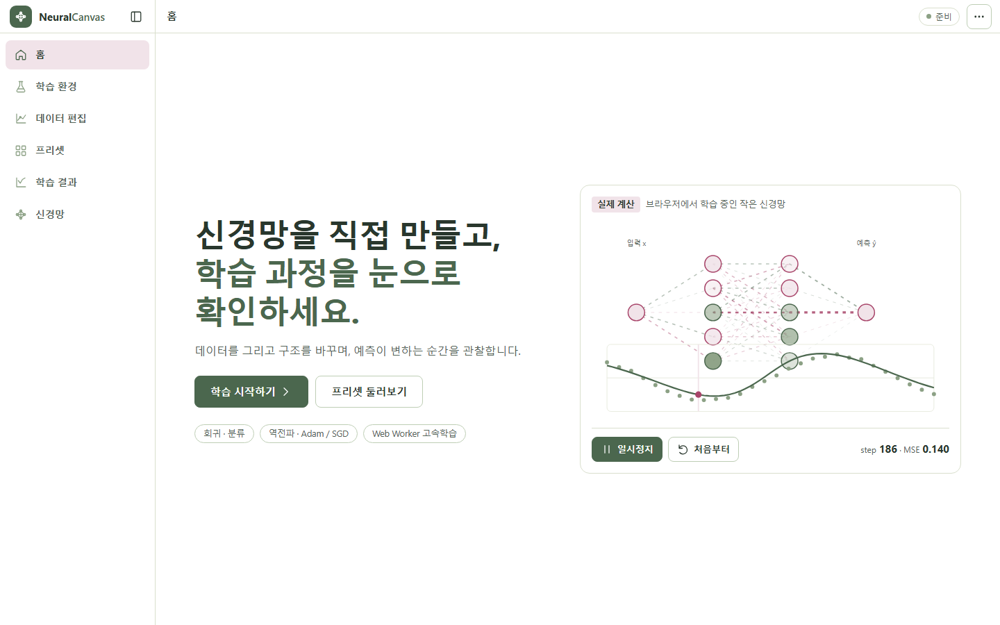 | 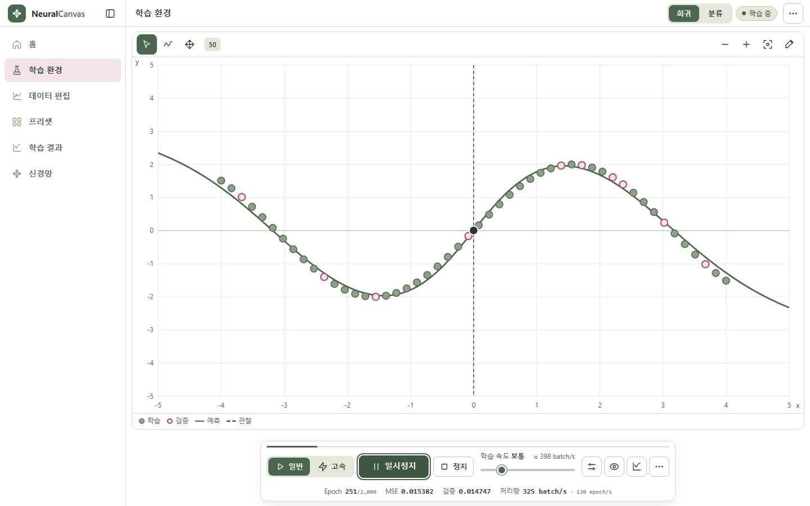 |
| 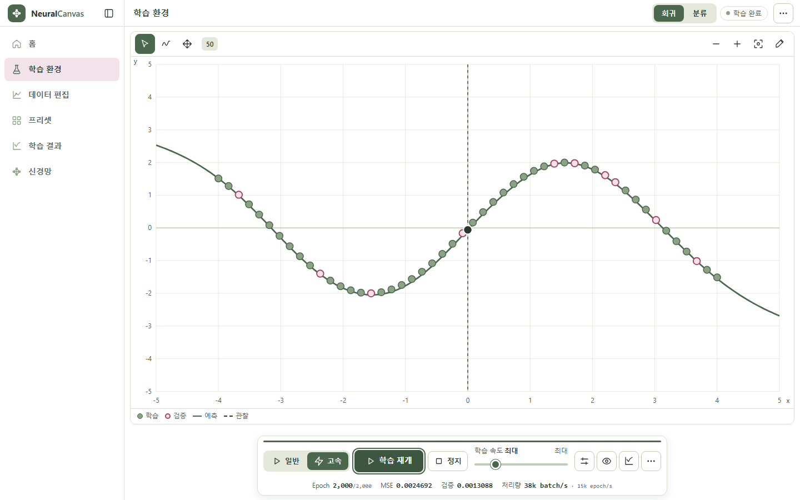 | 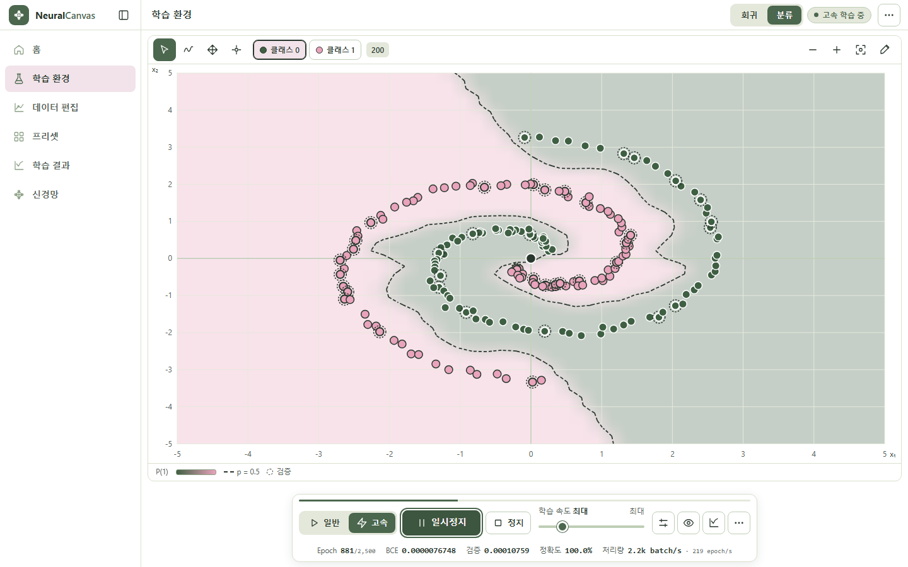 |
| 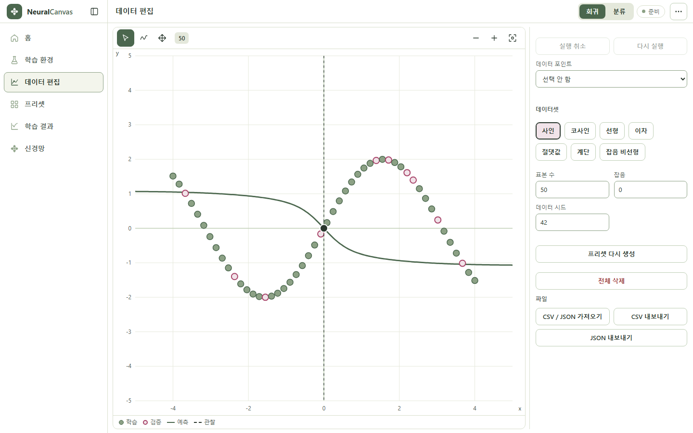 | 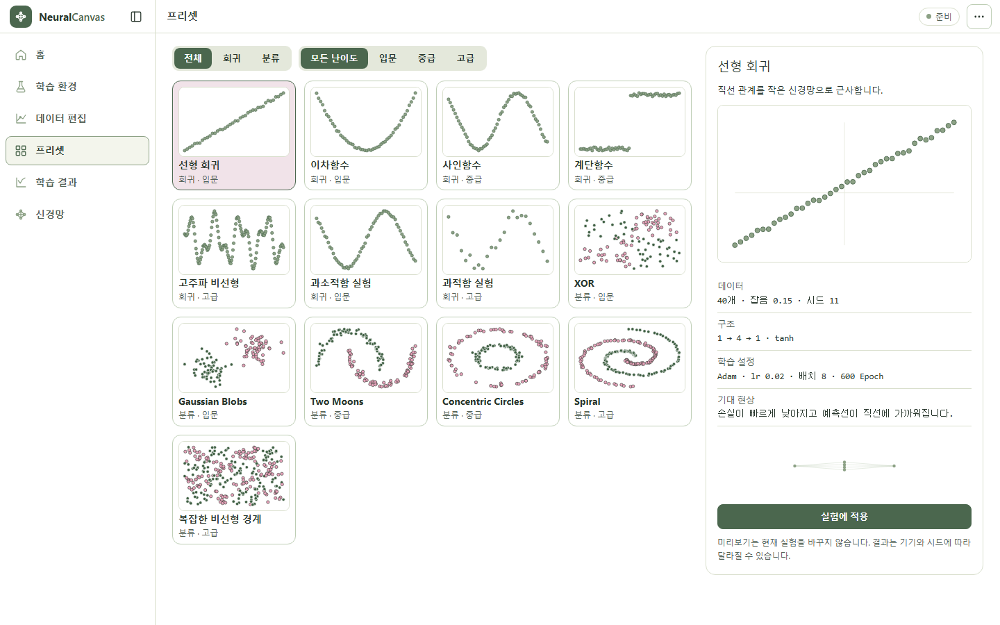 |
| 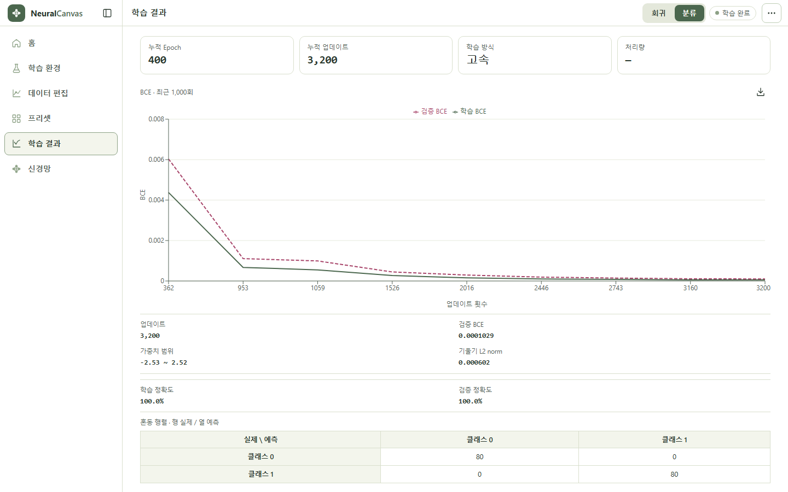 | 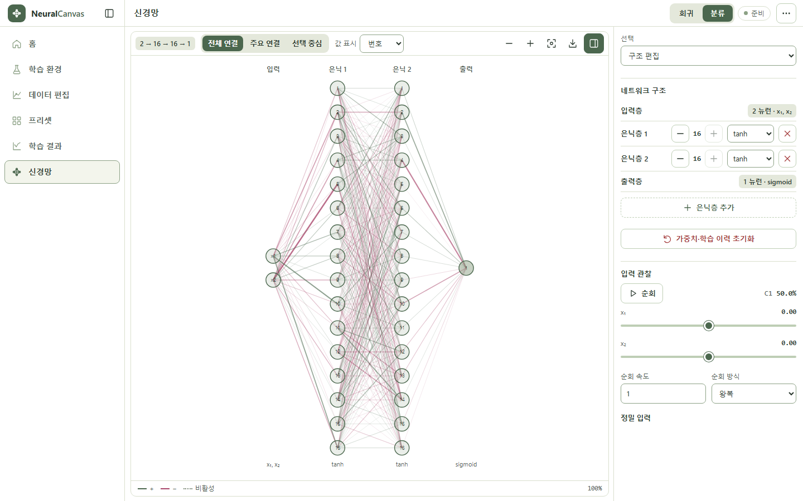 |
| 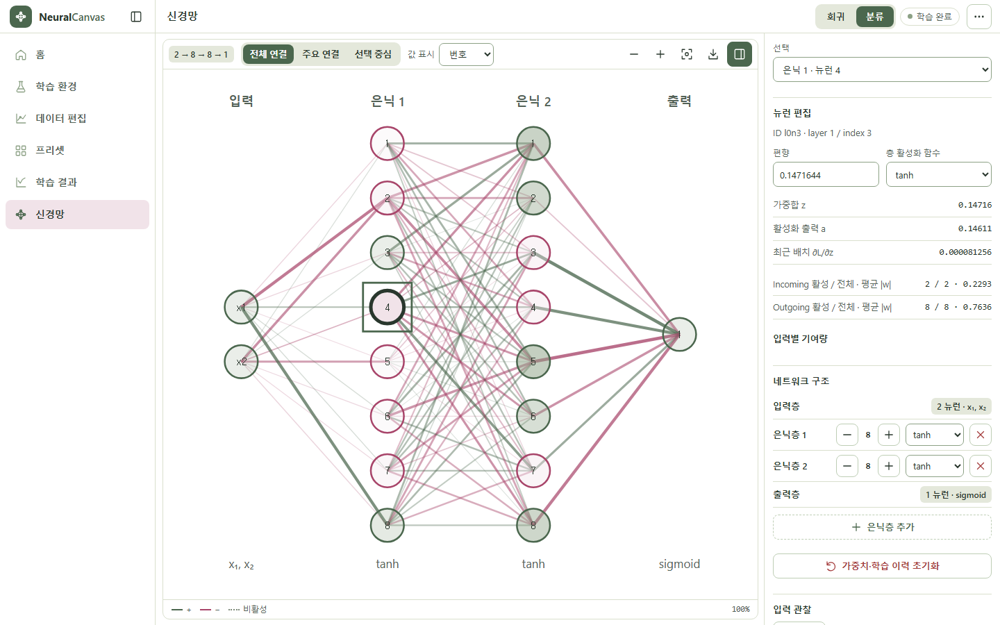 | 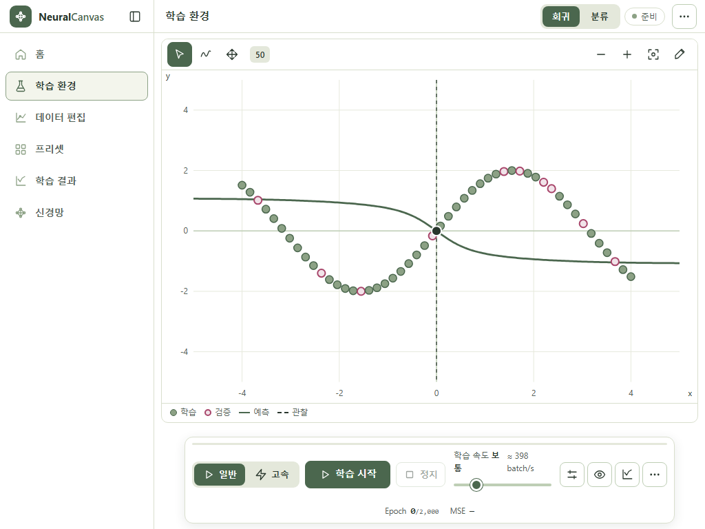 |

모바일(390×844, 360×800): 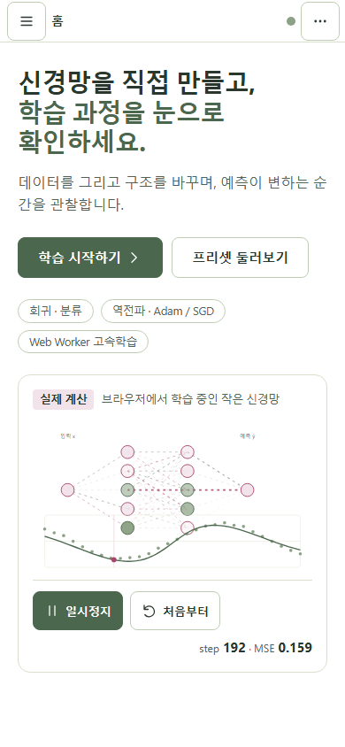 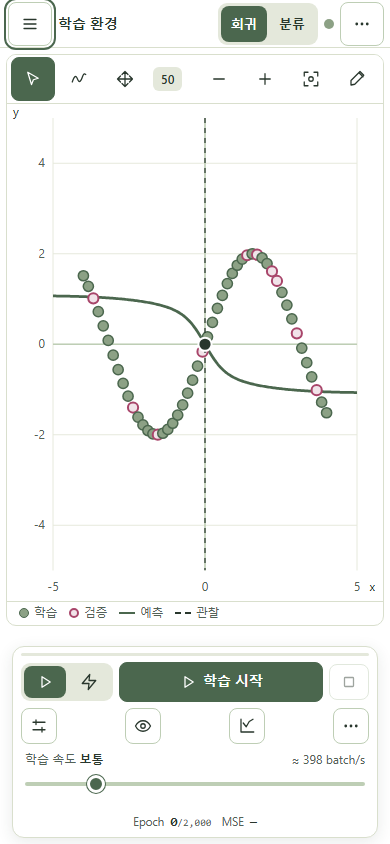 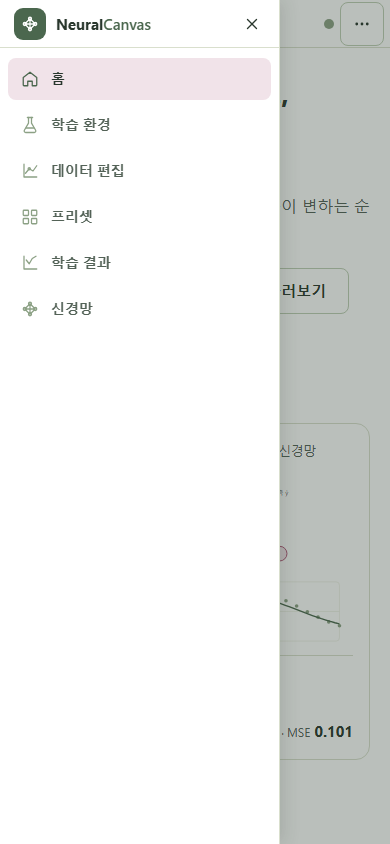 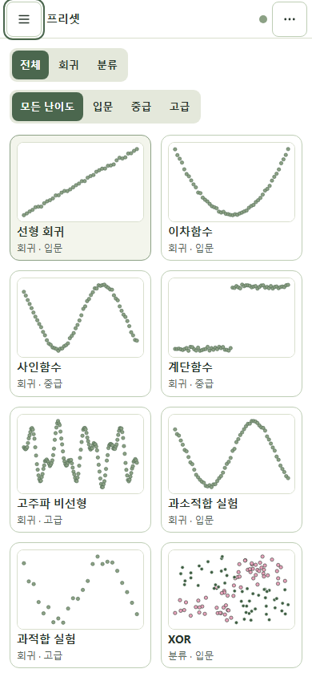 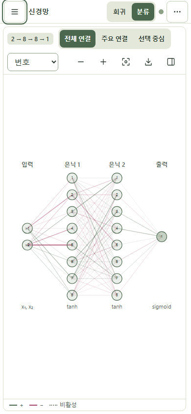 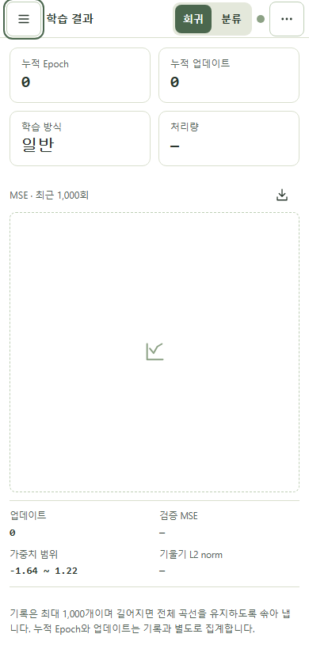
