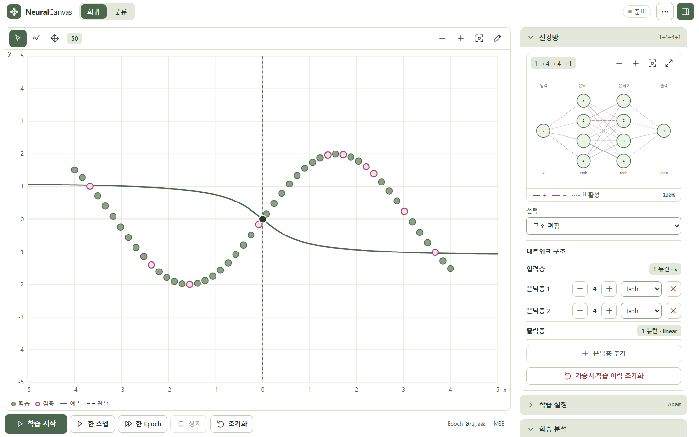
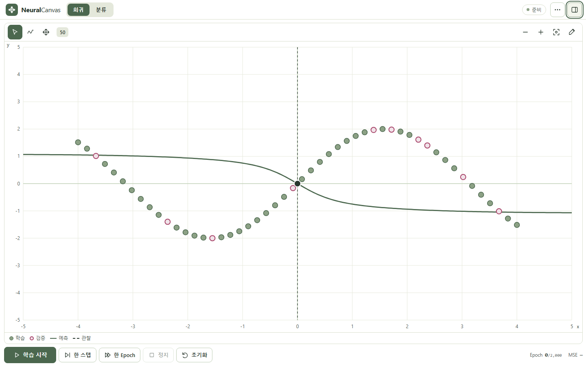
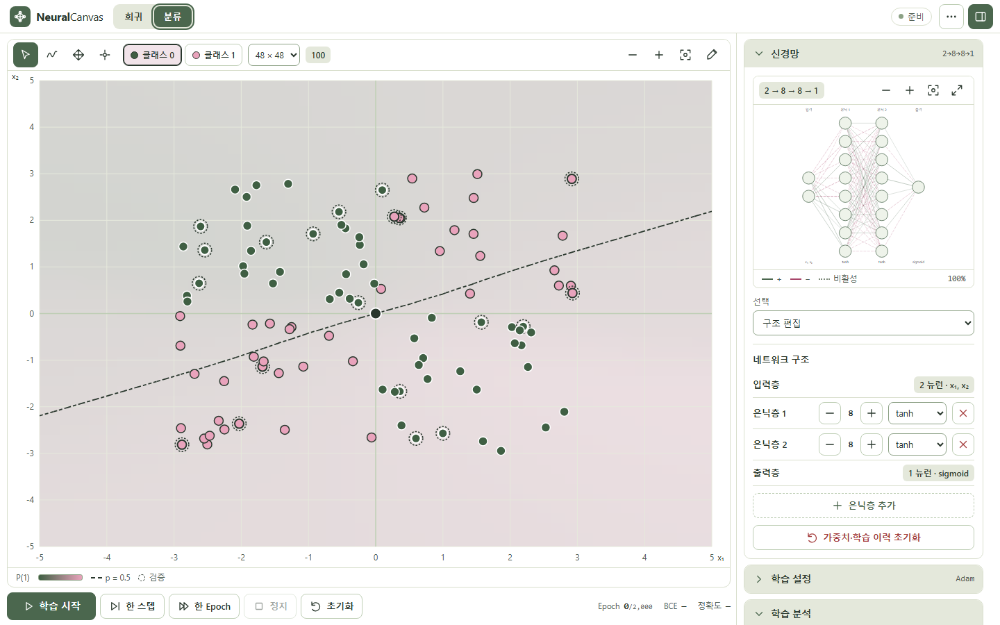
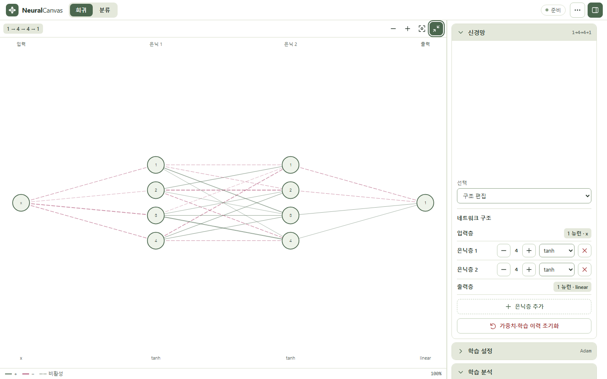
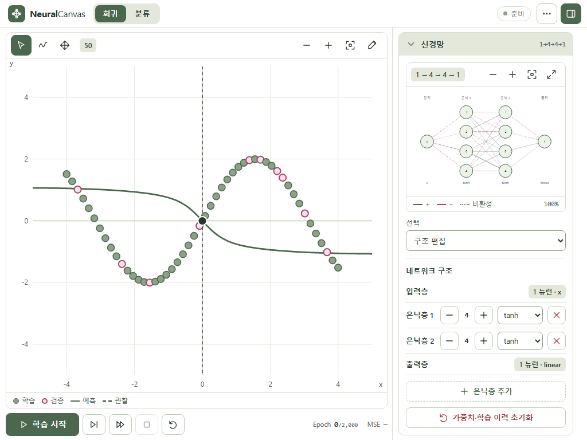
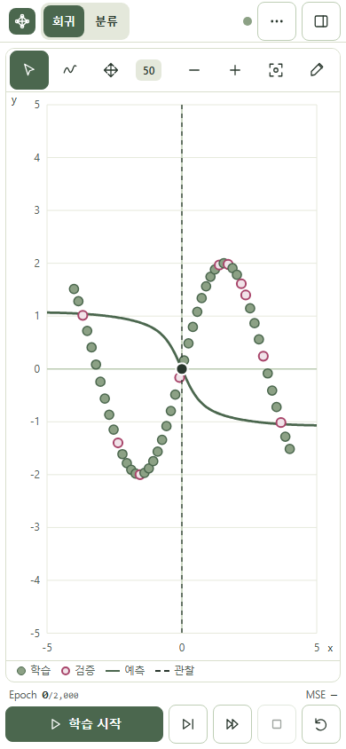
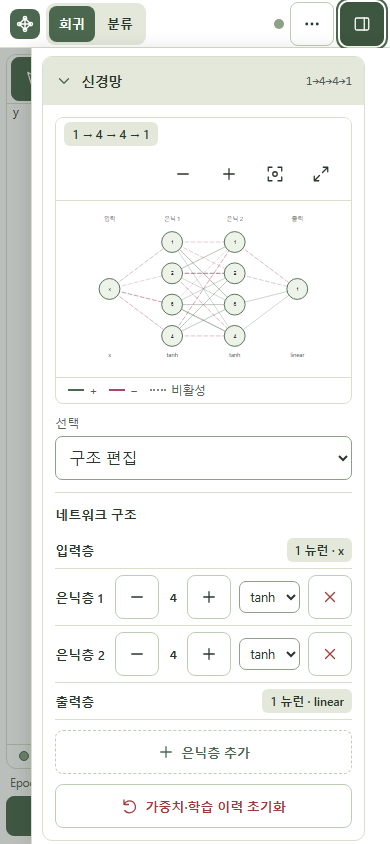

# UI/UX 전면 개편 — 데이터 그래프 중심 작업 공간 (2026-10-28)

## 레이아웃

데스크톱은 **헤더 48px → [데이터 그래프 | 접이식 사이드바] → 하단 학습 컨트롤** 한 화면이며 문서 전체는 스크롤하지 않습니다. 이전의 데이터/신경망 50:50 배치와 실험 제목·지표 영역, 공통 관찰 바, 접이식 분석 영역, 모바일 탭을 모두 제거했습니다.

- 신경망·학습 설정·학습 분석·입력 관찰·파일이 오른쪽 사이드바(340~380px)의 아코디언 5개로 통합됩니다. 각 영역은 독립적으로 접히고, 내용이 길면 사이드바 안에서만 스크롤합니다. 열림 상태와 아코디언 상태는 `localStorage`(`neuralcanvas-ui`)에 저장합니다.
- 사이드바를 닫으면 그래프가 빈 공간을 모두 사용합니다. 열기/닫기는 grid 열 너비 전환(0.22s)이며 `prefers-reduced-motion`에서는 전환이 없습니다. 그래프·신경망은 언마운트하지 않으므로 줌·이동·선택·데이터·가중치·학습 상태가 유지됩니다.
- 900px 이하에서는 같은 사이드바가 그래프 위의 오른쪽 드로어가 됩니다. 기본은 닫힘이며 토글·배경 탭·Esc로 닫고, 닫으면 포커스가 토글로 돌아갑니다.
- 신경망은 사이드바 안에서 확대·이동할 수 있고, 확대 보기 버튼은 같은 인스턴스를 그래프 영역 전체로 키웁니다(Esc로 복귀). 레이어 수정, 뉴런·연결 Inspector도 신경망 영역 안에서 동작합니다.
- 실험 이름, 저장, 불러오기, GitHub는 헤더의 더보기(⋯) 메뉴에 있습니다.
- 하단 컨트롤은 학습 시작/일시정지/재개(주 버튼), 한 스텝, 한 Epoch, 정지, 초기화와 Epoch·손실·검증·정확도 상태 줄입니다. 사이드바를 닫아도 사용할 수 있습니다.

## 그래프가 차지하는 면적

같은 Chromium에서 `data-plot` SVG의 실제 크기를 측정했습니다(뷰포트 대비 비율).

| 뷰포트 | 사이드바 열림 | 사이드바 닫힘 |
| --- | --- | --- |
| 1680×1050 | 1280×865 (63%) | 1660×865 (81%) |
| 1440×900 | 1040×715 (57%) | 1420×715 (78%) |
| 1280×720 | 880×535 (51%) | 1260×535 (73%) |
| 1024×768 | 664×583 (49%) | 1004×583 (74%) |
| 768×1024 | 754×820 (79%) | 드로어 |
| 390×844 | 376×640 (73%) | 드로어 |
| 360×800 | 346×550 (66%) | 드로어 |

이전 1440×900의 데이터 그래프는 670×418(약 22%)였습니다. 축 눈금은 그래프 크기에 맞춰 1·2·5 단위로 정리하고 점 크기도 캔버스에 비례해 조정합니다.

## 색상

| 역할 | HEX | 사용 |
| --- | --- | --- |
| 순백 | `#FFFFFF` | 페이지·헤더·그래프·사이드바·신경망·하단 컨트롤·드로어 배경 (2026-10-28 아이보리 `#FDFAF4`에서 변경) |
| 파스텔 핑크 | `#F1E3E9` | 선택 항목, 검증 점 채움 |
| 라이트 세이지 | `#BECEB5` | 테두리, 구역 구분(영역 헤더는 이를 흰색과 섞은 `#E4E8DB`) |
| 세이지 그린 | `#8CA185` | 학습 데이터 점, 아이콘 |
| 딥 세이지 | `#4B674E` | 주요 버튼, 활성 상태, 예측 곡선, 양수 가중치 |
| 다크 차콜 그린 | `#29372D` | 본문, 관찰 입력, 결정 경계선 |

의미 구분이 필요한 곳에는 팔레트를 확장했습니다: 검증 점·음수 가중치·검증 손실의 로즈 `#A8456A`, 위험 동작의 `#A33A3A`, 보조 텍스트 `#536257`. 분류 클래스는 짙은 세이지(`#3F5F43`)와 밝은 핑크(`#E9A3BC`)로 **명도 차이**를 두어 색각 이상에서도 구분되며, 클래스마다 대비되는 윤곽선을 씁니다. 검증 점은 회귀에서 핑크 채움+로즈 테두리, 분류에서 점선 링으로 표시합니다. 그라데이션은 확률 범례와 결정 경계 배경에만 쓰며, 글로우는 없고 그림자는 메뉴·드로어에만 약하게 사용합니다. 모든 파란색·주황색은 제거했습니다.

`src/theme.test.ts`가 WCAG 대비를 검사합니다: 본문·보조 텍스트·주요 버튼 라벨·선택 항목은 4.5:1 이상, 그래프 요소(학습 윤곽, 예측 곡선, 검증 윤곽, 경계선)는 3:1 이상, 두 클래스 색의 명도 대비 3:1 이상입니다.

## 삭제·축약한 문구

`신경망 실험실`, 큰 실험 제목과 `1차원 회귀 · MSE · Adam` 설명줄, `나의 첫 번째 신경망` 헤더, `관찰하거나, 연결을 바꾸어 보세요.`, `처음 사용하시나요?` 사용법, 일시정지·정지·데이터 변경 장문 안내, 실험 불러오기 안내, 각 패널 상단 캡션, 학습 원리 설명 패널, `Regression/Classification` 영문 병기, 좌표 힌트 문장, 결정 경계 계산 시간 표시. 필요한 설명은 `title` 툴팁으로 옮겼습니다.

알림은 하단 컨트롤 위의 토스트 하나(`role="status"`)로 통일했습니다. 일반 알림은 3초, 오류·불러오기 실패·데이터 부족은 7초 후 사라집니다. 데이터·설정·모델 편집으로 학습 이력이 초기화될 때와 모드 전환·학습 시작/일시정지에는 알림을 내지 않습니다(상태 표시와 지표가 대신합니다). 초기화 확인 대화상자는 유지했습니다.

## 보존한 기능과 상태

`engine.ts`, `training.ts`, `worker.ts`와 수학 테스트는 수정하지 않았습니다. 회귀/분류 전환과 모드별 보관, 데이터 생성·편집·Undo/Redo·프리셋, 점 편집·연속 그리기·탐색·줌·핀치·화면 맞춤, MLP 층·뉴런·가중치·편향·연결 편집, SGD/Adam, Web Worker 학습(일시정지·재개·한 스텝·한 Epoch), 예측 곡선·결정 경계·분류 지표, 입력 관찰, JSON v1/v2 저장·복원, CSV/JSON 가져오기, CSV·PNG 내보내기, 자동 저장이 그대로 동작합니다. 학습 설정을 바꾸면 세션이 초기화되는 기존 정책도 같습니다.

사이드바 내용은 열림/닫힘에서 리렌더 비용을 줄이기 위해, 닫힌 동안 신경망 props를 고정하고 분석은 보이는 동안만 렌더링합니다. 닫힌 사이드바를 다시 열어도 Worker는 새로 만들어지지 않습니다(테스트로 확인).

## 발견하고 수정한 문제

1. **터치 점 탭이 점을 삭제함** — 그래프가 커지면서 점을 탭할 때의 합성 click이 방금 열린 바텀시트의 `선택 점 삭제` 위에 떨어졌습니다. 드로어 안에서 시작한 pointerdown이 없는 포인터 click은 무시합니다(키보드 click은 영향 없음).
2. 열린 상태의 토글 버튼이 터치 후 hover 스타일에 덮여 아이콘이 보이지 않던 문제를 수정했습니다.
3. x축 마지막 눈금과 축 이름이 겹치던 문제를 여백 조정으로 수정했습니다.
4. 분류 클래스 색 대비 검사에서 짙은 클래스 위의 검은 검증 윤곽이 보이지 않아, 검증 표시를 별도 점선 링으로 분리했습니다.

## 검증

- `npm run typecheck`, `npm run build` 통과. `npm test`: Vitest 70개 통과(기존 66개 + 접근성 대비 테스트).
- `npm run test:e2e`: Chromium·모바일(390×844)·Firefox에서 **71개 통과, 13개 적용 대상 외 제외, 실패 0**. WebKit은 이 PC의 Windows 응용 프로그램 제어 정책이 Playwright WebKit 실행 파일을 차단해 로컬에서 실행하지 못했습니다. GitHub Actions(Ubuntu)가 WebKit을 포함해 실행합니다.
- 새 테스트(`tests/layout.spec.ts`): 8개 뷰포트(1680×1050 … 360×800)의 그래프 비율·넘침·시작 버튼 노출, 사이드바 개폐와 그래프 확대·상태 보존·새로고침 유지, 아코디언 독립 접힘과 사이드바 자체 스크롤, 학습 중 사이드바 조작(Worker 1개 유지), 회귀/분류 전환 레이아웃, 분석·입력 관찰, 신경망 확대 보기, 모바일 드로어(토글·배경·Esc·포커스), reduced-motion, 키보드 조작.
- 기존 시나리오(점 편집·정밀 좌표·Undo, 모델 편집, Worker 학습, JSON v1 호환·오류, PNG 시그니처, 분류 학습·경계·모드 보존, 터치 핀치·이동·키보드 높이)는 새 UI에 맞게 경로만 바꿔 모두 유지했습니다.

## 스크린샷

| | |
| --- | --- |
|  |  |
|  |  |
|  |  |

실제 휴대전화와 OS 키보드는 사용하지 않았습니다. 터치는 Chromium 에뮬레이션이고 키보드는 뷰포트 높이 축소로 모사했습니다.
