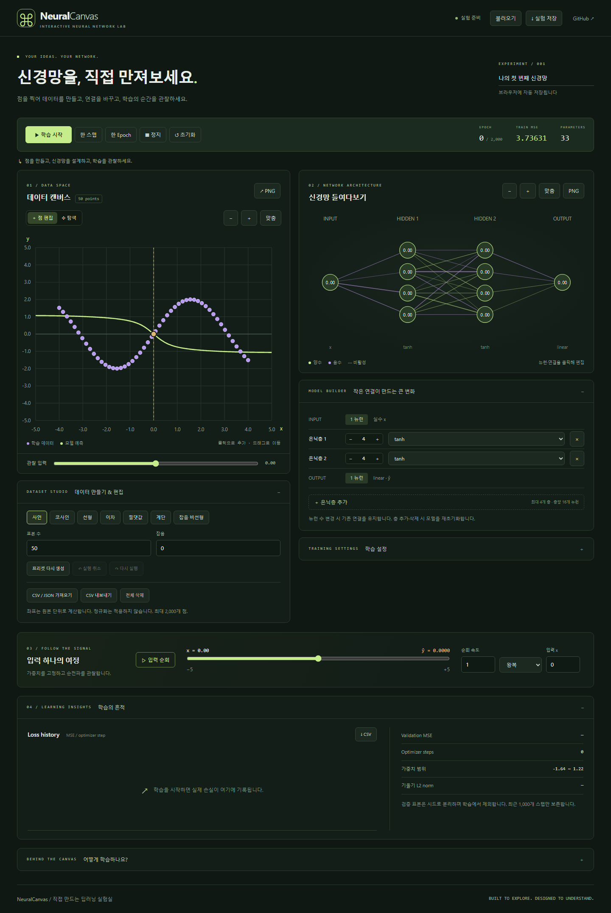
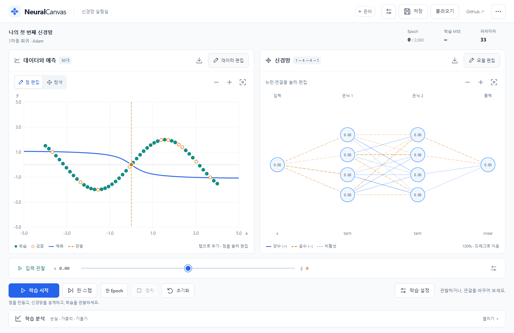
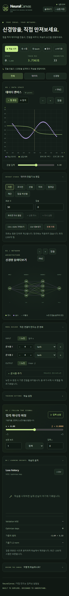
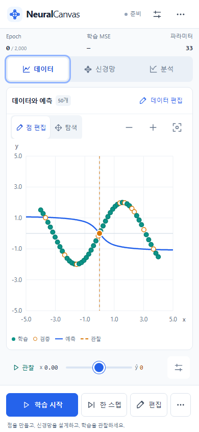

# UI/UX 개편 결과 — 2026-10-21

## 구현

화이트·중립 회색 배경, 파란 강조색, 청록색 데이터, 주황색 검증·관찰 입력으로 바꾸었습니다. 시스템 산세리프와 숫자용 모노스페이스를 사용하고 큰 Hero·장식 영문 문구·항상 펼친 설정 카드를 제거했습니다.

데스크톱은 64px 앱 툴바 → 실험 지표 → 데이터/신경망 50:50 → 공통 관찰 바 → 학습 도크 → 기본 접힌 분석으로 구성합니다. 모바일은 56px 툴바와 데이터/신경망/분석 탭, 한 개 시각화, 하단 학습 도크입니다. 모바일 기본 작업은 데이터입니다.

편집·설정·파일 메뉴는 데스크톱 우측 드로어, 모바일 바텀시트에서 엽니다. 점을 누르면 좌표·삭제가 앞에 나오며, 뉴런·연결 선택은 통합 모델 Inspector를 엽니다. 선택 목록을 제공해 겹친 점·연결과 키보드 조작도 지원합니다.

## 공간 비교

같은 브라우저의 실제 DOM bounding box와 전체 스크린샷을 비교했습니다. SVG 영역과 패널 전체 영역은 구분합니다.

| 항목 | 이전 | 변경 후 |
| --- | --- | --- |
| 390×844 모바일 전체 문서 높이 | 3,311px | 844px |
| 모바일 데이터 SVG 시작 위치 | y≈585px | y≈271px |
| 모바일 데이터 SVG 크기 | 360×276px | 356×370px |
| 모바일 조작 | 그래프·모델·설정·분석 세로 나열 | 한 작업 탭 + 고정된 학습 도크 |
| 1440×900 데이터 SVG 시작 위치 | y≈540px | y≈252px |
| 데스크톱 데이터 SVG 크기 | 약 642×492px | 670×418px |
| 데스크톱 신경망 SVG 크기 | 약 684×347px | 670×418px |
| 1440×900 첫 화면 | 데이터 그래프 아래가 화면 밖 | 두 시각화와 학습 도크 모두 화면 안 |

모바일 문서 높이는 약 74.5% 감소했고 데이터 SVG 면적은 약 32.6% 증가했습니다. 데스크톱에서는 데이터 SVG의 전체 높이를 줄여 두 시각화와 학습 컨트롤을 동시에 노출했습니다. 데이터·신경망 SVG의 합계 면적은 비슷하며, 각각의 면적이 모두 증가했다고 주장하지 않습니다.

### 데스크톱 전후

| 이전 | 변경 후 |
| --- | --- |
|  |  |

### 모바일 전후

| 이전 | 변경 후 |
| --- | --- |
|  |  |

[모바일 신경망](images/redesign/mobile-network.png) · [점 편집 바텀시트](images/redesign/mobile-point-sheet.png)

## 보존한 기능과 상태

- `engine.ts`, `training.ts`, `worker.ts`, 기존 수학 테스트는 변경하지 않았습니다. Worker 빌드 해시도 유지했습니다.
- MLP 순전파·역전파, SGD/Adam, 시드·초기화·마스크, 실제 손실·예측·활성화 계산을 유지했습니다.
- 탭은 시각화를 재마운트하지 않고 CSS로 표시를 바꿉니다. 모델·데이터·Epoch·입력·선택·줌·이동 상태를 유지합니다. 드로어와 탭 조작 중 Worker 생성 수가 증가하지 않는지 검사했습니다.
- 편집 시 기존 revision 증가·Worker 종료·학습 이력 초기화 정책을 유지했습니다. 일시정지는 Optimizer를 유지하고 정지는 가중치를 유지하며 세션을 종료합니다.
- 실험 JSON v1과 기존 파일의 호환성을 유지했습니다. 반올림은 표시만 바꾸며 포커스 시 원본 정밀도를 편집합니다.
- CSV/JSON 가져오기, JSON 저장·복원, 데이터·손실 CSV, 그래프·신경망 PNG를 유지했습니다. PNG 배경도 흰색으로 변경했습니다.

## 터치·접근성

그래프는 두 손가락 핀치와 탐색 모드 이동을 지원합니다. 신경망은 한 손가락 이동과 핀치를 지원합니다. 점 이동은 손을 놓을 때 한 번 커밋하여 Undo 한 번으로 복구합니다. 뷰포트 조작은 실제 모델·데이터를 변경하지 않습니다.

주요 모바일 버튼·입력은 44px 이상이며 숫자 입력은 16px와 decimal/numeric 입력 모드를 사용합니다. 모바일 safe area, 100dvh, visualViewport 높이 변경, 바텀시트 내부 스크롤을 처리합니다. 네이티브 dialog로 포커스를 가두고 Esc·닫기 후 열기 버튼 또는 원래 그래프로 복원합니다. 숨긴 탭의 포커스는 제거됩니다.

## 발견하고 수정한 문제

1. 숫자 필드가 반올림 값에서 원본 값으로 전환되는 순간 선택 범위가 사라져 새 입력이 뒤에 붙었습니다. 포커스 시 원본 값을 동기 적용하고 전체 선택하여 정밀도를 보존했습니다.
2. WebKit에서 모달이 열린 뒤 자동 포커스를 기준으로 복원 대상을 기록하는 문제가 있었습니다. 열기 직전 버튼·그래프를 명시적으로 기록해 복원합니다.
3. 핀치·이동 직후 호환 click이 생략되는 터치가 있었습니다. 화면 맞춤은 터치 pointerup에서도 즉시 처리하고, 제스처 종료 시 포인터 캡처를 해제합니다. 확대율이 정확히 1로 복원되는 검사를 추가했습니다.
4. 줌 후 화면 밖의 점을 누르는 테스트를 화면 맞춤 후 선택하도록 수정했습니다. 실제로 클리핑된 점을 보이는 것처럼 처리하지 않습니다.
5. 학습 재개는 고정된 지연 대신 실제 Worker 업데이트 증가를 기다려 검증합니다. 독립 Playwright 명령이 같은 결과 폴더를 동시에 지우지 않도록 한 번의 실행 안에서 병렬화합니다.

## 품질 검증

Vitest 33개가 기존과 동일한 수치로 통과했습니다. 최대 기울기 상대오차 약 3.2×10⁻⁹, 선형 회귀 최종 MSE 4.53×10⁻¹⁹, 사인 회귀 최종 MSE 0.00013939입니다. 타입 검사와 프로덕션 빌드도 통과했습니다.

최종 로컬 브라우저 검증은 **45개 통과, 0개 실패, 3개 적용 대상 외 제외**입니다. 전체 구성은 48개로 Chromium, 390×844 모바일 Chromium, WebKit, Firefox에서 기능 및 8개 뷰포트를 검사합니다. Chromium 전용 CDP 멀티터치는 모바일에서만 실행하고 다른 3개 프로젝트에서는 명시적으로 제외합니다. 공개 배포 검증은 최종 보고에서 별도로 구분합니다.

뷰포트: 360×800, 390×844, 430×932, 768×1024, 1024×768, 1280×720, 1440×900, 1680×1050. 가로 넘침, 첫 화면 그래프·도크, 탭 전환, 데이터/모델 편집, 정밀도, Worker 재개, 한 스텝/한 Epoch, 관찰, JSON/CSV/PNG, 드로어 포커스·Esc, 핀치·이동·맞춤과 작은 키보드 뷰포트를 검사합니다.

실제 휴대전화나 실제 iOS/Android OS 키보드는 사용하지 않았습니다. 터치는 Chromium 에뮬레이션이며 키보드는 뷰포트를 390×480으로 줄여 모사했습니다. WebKit 테스트는 실제 iPhone Safari 기기 검증과 구분합니다.

## 렌더링 성능

같은 Windows 장치(Intel Core Ultra 7 256V), Node.js 24.19.0, Chromium 156, 헤드리스 1440×1000에서 각 약 2초간 측정했습니다. Adam .01, 배치 16, speed 20, 시드 42를 사용했습니다. 독립 측정의 단일 실행값이며 지속 성능 보장은 아닙니다.

| 모델 / 데이터 | 메인 스레드 작업 비율 이전 → 이후 | rAF 빈도 이전 → 이후 | 이후 50ms 이상 작업 |
| --- | --- | --- | --- |
| 4→4 / 50개 | 35.64% → 8.94% | 60.50 → 60.00Hz | 0 |
| 16→16→16→16 / 500개 | 41.00% → 25.71% | 60.01 → 60.00Hz | 0 |

메인 스레드 작업 시간은 각각 738.65→180.92ms, 848.82→522.05ms였습니다. 전체 GPU FPS와 CDP TaskDuration은 다른 지표입니다.

예측 경로를 모델·뷰포트별로 캐시하고, 숨긴 모바일 시각화의 렌더링을 줄였습니다. 분석은 펼칠 때만 렌더링하며 Recharts를 지연 로드합니다. 초기 JS는 압축 전 약 620KB에서 약 281KB로 감소했습니다. 차트용 약 375KB 청크는 분석을 열 때 별도로 로드합니다. `node scripts/browser-benchmark.mjs`로 재현할 수 있습니다.
